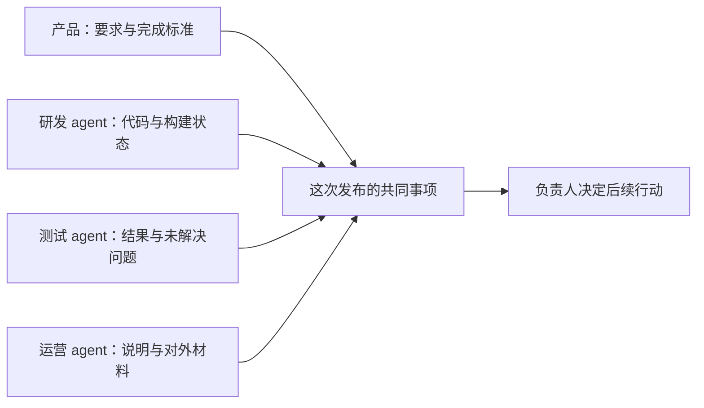

# 公司内部的个人 agent：产品设计与试点场景

日期：2026-09-29。本文是产品方案，未实现这些新能力，也未验证业务效果。延续 i-bot 一 bot 一独立环境、个人授权与插件按需加载的设定。网页可使用轻部署或 sandbox 预览承载结果；网页托管方式不决定本文的产品方向。

## 1. 产品定位与日常使用

**每个人有一个能理解自己工作背景的 agent，能接手事情、主动准备、持续跟进，并在明确范围内替自己参与协作。**

一个员工的背景包括职责、正在负责的事项、常用资料、相关讨论与已有授权。个人 agent 使用这个背景完成工作；同事能提交允许的协作请求；公司提供可复用的做法和资料。个人草稿、记忆、登录与电脑不因为加入公司而自动共享。

用户的日常体验可以从四句话开始：

- “这件事交给你。”从消息、工单、文档或链接继续工作。
- “接着我刚才的工作做。”在明确交给 agent 的环境里处理余下操作。
- “这件事替我持续跟进。”主动检查进展与阻塞，准备下一步。
- “这类请求以后可以找我的 agent。”在已授权范围内接收并处理同事请求。

用户不需要了解 webhook、队列或端口。对新职责只确认必要的范围；已授予的权限正常沿用。用户随时能够改方向、接手或停止。

## 2. 参考与我们的设计判断

- Slackbot 的官方说明将个人工作上下文、已有访问权限、资料整合和准备内容放在核心位置。它证明“知道我正在做什么”是一种产品方向，不能据此假设我们已获得飞书或其他公司数据。[官方说明](https://slack.com/blog/news/slackbot-context-aware-ai-agent-for-work)
- Asana 官方说明把 AI Teammate 放进任务分配、项目目标与既有工作流程里。对我们有启发的是工作有归属、进度和结果；本次不采用其营销效果数字。[产品说明](https://asana.com/product/ai/ai-teammates)、[使用说明](https://help.asana.com/s/article/get-started-with-asana-ai)
- Grok Bot 的官方文档描述 bot 群聊、异步交接、共享目标和每一步明确负责人。它描述的 bot 协作不能直接当作跨员工代理的身份和权限契约。[协作文档](https://docs.x.ai/grok-bot/chat-and-collaboration)

以下产品设计是针对 i-bot 的建议，不声称为行业首创。

## 3. 六项值得探索的产品能力

### 3.1 把一条讨论交给我的 agent

**场景：** 产品经理在飞书讨论里收到一个需求，希望 agent 继续收集资料和跟进。

**入口：** 对某条消息、工单或文档选择“交给我的 agent”，也可以把链接发给它。

**体验：**

1. 读取本人可访问的原材料，识别目标、明确要求、时间与相关人；分清原文事实和推断。
2. 给出它将做的事情。已清楚且已授权的任务直接开始；缺少关键信息时才询问。
3. 工作中收到补充材料或状态变化，继续同一事项，不重复新建任务。
4. 结果回到原讨论、工单或个人对话中由用户选择的地方；保留来源与交付链接。

**完成示例：** 整理需求差异、查到三个相关历史问题、准备一份可评审材料；其中两项仍需产品经理决定。

**价值：** 减少重新描述背景、重复搜索和在多个工具之间搬运信息。

**必要控制：** 用户能看到来源、当前范围、结果去向和停止按钮。未接入的平台先以链接与手动分享材料验证，不能假装可读取全部历史消息。

### 3.2 接着我做到一半的工作做

**场景：** 运营人员已经打开后台并筛选订单，需要继续核对、导出、整理或录入另一系统。

**入口：** 在 bot 的当前桌面或浏览器里选择“交给 agent”，补充剩余目标；必要时录制一次操作。

**体验：**

- agent 读取当前已授权环境，确认页面和任务状态，执行余下工作。
- 人工与 agent 操作同一桌面时，控制权明确交接；接手后从实际状态继续。
- 完成后返回结果文件或已完成的记录，并说明异常；桌面保持可以继续查看。
- 验证成功后，把方法保存为个人技能。需要分享时去除个人账号、客户数据与结果文件，再发布做法。

**价值：** 用户可以先自己开始，碰到重复步骤时交给 agent；不要求事前把全过程设计成自动化。

**实现范围：** 第一批使用现有 sandbox 与录制能力。本机浏览器扩展或本机执行是独立后续方案，不能当作当前已接通。

### 3.3 主动准备我下一步需要的工作

**场景：** 明天有客户会议，或负责的需求快到评审时间。

agent 从已授权的日程、当前事项和相关资料中发现准备需求，先核对并产出私人材料。用户看见的内容应该是：

> 明天客户会议材料已准备。上次遗留的接口问题有了新回复，报价仍待确认。这里是三项议题和相关依据。

它还可以发现项目状态与文档不一致、必要材料缺失或已有承诺尚未落实。相关证据不足时标明未知，不根据沉默推断延期或完成。

**交互：** 已准备的内容、为什么准备、引用来源、继续处理、忽略、关闭这类关注。私人准备不自动发到群里。

**价值：** 用户直接从可用材料开始处理；减少遗漏与临时准备。

### 3.4 同事可以找我的 agent 办事

**场景：** 同事想了解我负责的功能进展、取得允许分享的材料，或提交一个需要我处理的请求。

**入口：** 公司目录中的个人 agent，或经过平台接入的工作会话。显示它属于谁、能够受理哪些请求。

**请求体验：**

1. 提交目标、必要材料、期望结果与期限；自然语言输入后由 agent 补齐必要字段。
2. 查询类请求在允许分享的资料范围内处理；代办请求按本人已经授予的范围接受。
3. 请求方能看见已接收、处理中、需要补充、等待本人、已完成或拒绝。
4. 完成后返回结果与依据，并让本人知道已经处理了什么。

**例子：** “请帮我确认这个功能的当前测试状态。”agent 查询允许分享的任务和测试记录，返回已验证的状态；没有新结果时说明仍待更新。

**价值：** 常见协作请求有明确入口和后续状态；负责人忙碌时也能处理已有授权覆盖的请求。

**必要边界：** 明确标识为本人的 agent；不冒充本人已作出承诺。别人不能通过发请求扩大本人的权限或支配其全部用量。默认不分享个人草稿、私聊或登录；超出范围转给本人。

### 3.5 临时组成一个围绕结果的工作小组

**场景：** 一次产品发布需要产品、研发、测试和运营共同准备。

**入口：** 建立一个明确事项，邀请相关人员及其 agent，写出完成标准。

**体验：** 各 agent 在自己的环境中处理所属职责，将可分享的结果交回同一事项。每步只有一个明确负责人；各方能查看请求、结果、阻塞和等待对象。用户可以中途修改要求。

**价值：** 减少人逐一追问与转述；出现阻塞时只把需要本人处理的部分提出。

**实施次序：** 先支持同一人的多个 bot 分工，再做跨员工请求。跨员工协作需要组织成员、可分享结果和接收权限；不能从现有 spawn_task 推断这些已具备。

### 3.6 公司可以提供验证过的做法

**场景：** 一个运营人员教会 agent 核对订单；公司希望其他人也能用这个方法。

**入口：** 从一次成功任务或录制产生技能草稿，补充输入、检查方法、异常和授权范围。经维护者验证后，发布为公司可用插件或技能。

**体验：** 员工选择职责或任务时看到适用做法；使用前说明需要哪些账号和资料。每个人连接自己的账号，在自己的 bot 环境执行。版本变更显示影响，可以停用或回退。

**价值：** 一个员工验证过的方法可被其他人采用；个人 agent 学会公司要求，也能保留本人允许的偏好。

**必要边界：** 共享方法，不默认共享个人材料、凭证或客户结果。公司规则和个人偏好冲突时，以明确权限和公司要求约束执行。

## 4. Webhook 可以如何成为具体产品体验

Webhook 是接收变化的技术方式。用户可以围绕“我负责什么事情”“什么请求可以交给我”配置体验。底层根据来源选择 webhook、连接器事件或定期查询。

### 4.1 跟进一件事情

用户说：“跟进这个需求，准备评审和上线材料，卡住时找我。”

系统关联本人允许读取的工单、文档、PR 和讨论。各来源变化合并到同一事项，agent 判断是否需要行动。例如需求更新后检查已有测试是否覆盖，准备差异清单；构建失败后收集日志；验收完成后整理交付说明。

用户主要查看当前进展、最近处理、等待对象与下一步。选择哪种事件传输由系统处理。

### 4.2 接待具体的内部请求

例如“请求一份测试环境”“需要查一个客户问题”“准备一份项目资料”。每种请求有必要输入、可做范围、负责人、交付形式与完成标准。

请求可来自表单、工作会话、工单或 webhook；缺信息时先补齐，重复请求关联到原事项。接收方按自己的权限处理。复杂问题可转给指定负责人，保留原材料与已做工作。

产品界面主要是请求类型、所属 agent、材料、范围、结果和状态；技术人员在连接来源时配置接收地址。

### 4.3 在我离开时继续处理已授权事项

本人设置起止时间、允许处理的请求、可分享资料和需要本人或代理同事决定的事项。agent 可以回答已有事实、准备材料、继续已授予范围内的工作。

超出范围转给指定的人；回来后按事项给出已经处理、未完成和待决定的内容。不能因进入代办状态就代替本人承诺交期、批准费用或扩展授权。

### 4.4 异常发生后先准备处理结果

例如客户反馈或失败构建到达时，agent 关联已有事项、核对影响、收集证据、在已授权测试环境复现，产出处理材料。获得修复权限时推进允许的操作；产品经理或研发看到已经核实的事实、已完成动作和仍需决定的内容。

不能把通知送达当成事务已解决；完成标准要对应实际系统状态或可检查的交付。

## 5. 结合公司岗位的首批场景

| 使用者 | 实际事项 | agent 可以持续负责 | 结果 |
| --- | --- | --- | --- |
| 产品经理 | 一个需求从讨论到交付 | 汇集要求、发现差异、准备评审、查证进度与阻塞 | 评审材料、待决定问题、交付说明 |
| 研发 | 负责功能的技术与协作事项 | 收集复现材料、在授权环境验证、准备代码或文档修改、关联当前任务 | 可检查的修改、测试证据、明确未知项 |
| 测试 | 上线前验收 | 关联要求与测试结果、检查遗漏、整理失败与回归情况 | 验收材料、未完成项和依据 |
| 运营 | 订单、活动与数据整理 | 继续后台操作、核对记录、准备文件、处理允许的重复事务 | 已处理记录、输出文件和异常清单 |
| 销售或客户成功 | 一位客户的持续问题 | 整理沟通、核对内部进展、准备答复与下一步 | 有依据的回复和跟进事项 |
| 行政或新员工 | 一批重复内部请求 | 查找适用要求、补齐材料、按授权提交或分派 | 请求完成、可见状态与后续指导 |

选择场景时要求有实际资料、账号和明确完成标准。生产发布、费用批准和对外承诺按照已有授权执行，不把试点能力扩大成默认权限。

## 6. 建议的第一条公司试点

**先验证“个人 agent 跟进一个真实需求，并把材料和结果送回现有工作位置”。**

初始只选少量产品、研发或测试用户，每人保持独立 bot。接入一个沟通来源和一个任务或代码来源；其他材料先以链接分享。用一个真实需求验证：

1. 原讨论交给本人 agent，关联实际工单与资料。
2. 根据本人范围准备材料、核对状态，并从变化中发现下一步。
3. 遇到缺失测试或资料时先准备具体清单；只有需要人决定时通知。
4. 按授权更新允许的记录或交付结果；用户能接手和停止。
5. 验证完成后，保存方法供本人重复使用，再探索分享给公司。

后续增加内部请求，再扩展跨员工 agent 协作。这样每一步都有可检验的价值，同时减少初期需要实现的组织功能。

观察指标：为了完成该事项用户追问和转述的次数、结果被实际采用的次数、缺信息造成的往返、漏掉的期限或依赖、错误主动建议、任务恢复和每项完成工作的用量。先建立试点基线，再讨论目标，不采用竞品营销数字。

## 7. i-bot 已有基础与新增需求

| 已有基础 | 可以支持的起点 | 仍需实现 |
| --- | --- | --- |
| 浏览器、桌面、终端和人工接管 | 接手当前工作，处理真实后台事务 | 持久等待与动作授权、可靠恢复 |
| 录制与技能草稿 | 教一次、验证后重复用 | 公司成员、维护者、分享和版本推广 |
| 插件与卡片模板 | 按职责安装做法；展示请求、结果和选择 | 实际来源连接、持续事项、请求状态和交付 |
| 后台任务与 SSE | 执行期间继续聊天并回传结果 | 持久任务和事件、主动关注、离线通知 |
| 独立 sandbox | 分开账号与不同业务环境 | 跨 bot / 跨员工的明确请求与结果分享 |

本次直接核对到 schema 中 `org` 仍为保留项，没有组织表；不能把公司插件共享、成员权限和跨员工协作当成现有功能。[数据库定义](/Users/mac/dev/i-bot/packages/db/src/schema.ts:58)

录制与技能草稿已有实现入口；公司共享仍需另外设计。[录制实现](/Users/mac/dev/i-bot/apps/api/src/agent/recording.ts:1)、[卡片模板](/Users/mac/dev/i-bot/apps/api/src/plugins/ui-templates.ts:1)

持续职责、接收到的请求、运行状态和待决定事项保存在平台数据库，资料保留来源与权限。模型负责判断内容和下一步；平台负责身份、归属、执行范围、重试、用量与结果可达。具体技术方案另行制定，不在本次产品讨论中改动锁定的技术体系。

## 8. 首次界面可以长什么样

- **个人对话**：交代事情、继续原事项、调整方向与停止。
- **当前事项**：正在负责什么、最近处理、等待对象和下一步。
- **需要本人处理**：必要选择、缺信息、网页登录或超范围动作。
- **已准备与已完成**：直接打开材料、文件、系统记录或共享结果。
- **请求入口**：允许同事提交的请求类型，先从简单范围开始。
- **公司做法**：经验证的技能或插件，需要的账号、适用范围和维护者。

结果继续使用现有右侧区域、文件或卡片；网页可以采用轻部署或 sandbox 链接。分享之前明确访问对象和链接有效期；不能因生成了链接就视为公司成员均可访问或长期有效。

相关总方案：[个人 agent 产品方向](/Users/mac/dev/i-bot/docs/research/personal-agent-product-directions.md)。
