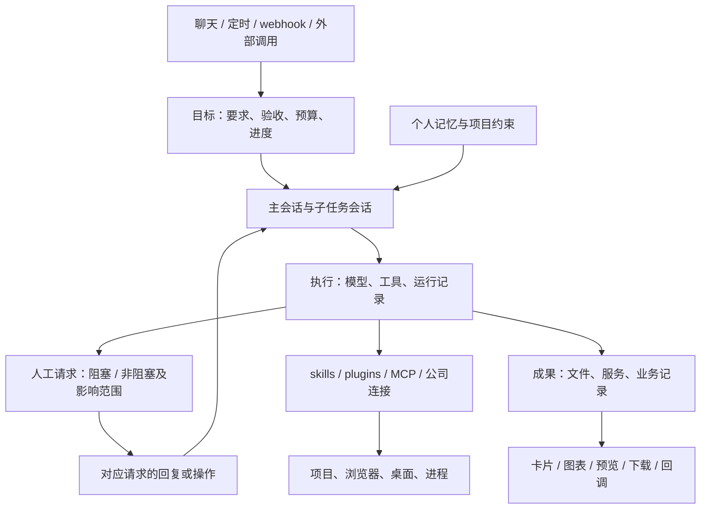

# i-bot 目标执行、会话与成果交付评审

日期：2026-09-30。范围：当前工作目录中的实现，包含尚未提交的功能；Pi 官方源码；Codex 官方文档。本轮为代码和文档评审，没有运行外部模型验证这些产品流程，也没有修改执行逻辑。

## 结论

可以继续推进，但实现前需要统一执行状态的归属，并处理架构说明与运行代码的差异。

当前已有模型与工具循环、后台任务、子任务结果回传、人工桌面接管、skills/plugins/MCP、定时与 webhook 自动化、网页初始化和右侧预览。主要缺口是：持久目标与验收、可恢复的子任务会话、按子任务保存的人工请求、统一的项目/服务/成果记录，以及公司平台连接和网站登录态管理。

`goal` 当前是任务描述参数，不是独立的目标管理功能。执行结束与目标完成尚未分开。应该把“做到了什么、还差什么、下一次如何继续”保存到数据库，而不是依赖模型每次读到历史后自行猜测。

本文的建议均为待实现设计，不代表这些能力已经存在。

后续结合 OpenMuse、AG-UI、Gmail 等应用连接的补充见 [个人 agent 应用层能力评审](./personal-agent-application-capabilities.md)，包含凭据与插件、通知、文件编辑、软件安装、sandbox 临时下载和 R2 长期成果的区别。

## 一、当前实现证据

| 方面          | 已确认的实现                                                                                                                                                                          | 当前边界                                                                                                                   |
| ------------- | ------------------------------------------------------------------------------------------------------------------------------------------------------------------------------------- | -------------------------------------------------------------------------------------------------------------------------- |
| 单次执行      | [run.ts](../../apps/api/src/agent/run.ts) 使用 AI SDK `streamText`；普通执行最多 24 步，网页创作最多 48 步；`request_handoff` 结束当前执行                                            | `onFinish` 进入 `done` 处理，没有独立验收器。达到步数限制或模型不再调用工具，不能证明用户目标已完成                        |
| 后台与子任务  | [jobs.ts](../../apps/api/src/agent/jobs.ts) 保存 `agent_jobs`，后台运行，向主对话回传最终文字；任务目录为 `/root/tasks/<jobId>`                                                       | 任务说明截取 500 字，结果截取 4000 字；子任务内部消息没有独立会话存档；重启后仍为 running 的任务被标记 error，不会恢复执行 |
| 父子关系      | [schema.ts](../../packages/db/src/schema.ts) 已有 `parentJobId` 字段                                                                                                                  | 当前启动路径未使用它建立完整的父子会话、分支及依赖关系                                                                     |
| 人工参与      | [chat.ts](../../apps/api/src/routes/chat.ts)、[manager.ts](../../apps/api/src/sandbox/manager.ts) 支持 `request_handoff`、等待提示、桌面控制权及运行中追加指令                        | 普通等待标记按 bot 保存于内存；子任务没有单独的人工请求。新的前台执行会清除该标记，不能用它可靠表示每个分支的等待情况      |
| 自动化恢复    | [automations/manager.ts](../../apps/api/src/automations/manager.ts) 使用持久运行记录、租约及 waiting 状态；等待中的运行会阻止该 bot 的后续自动化                                      | 这是已有的持久等待基础，不能笼统说没有人工参与；它还不是通用的子任务独立等待机制。中断后不自动重放操作                     |
| 模型上下文    | [history.ts](../../apps/api/src/agent/history.ts) 保留最近 80 条消息和两张完整截图，数据库原消息保留                                                                                  | 不是语义压缩；较早的任务约束可能不再进入模型上下文                                                                         |
| skills 与经验 | [skills.ts](../../apps/api/src/agent/skills.ts) 按 bot 读取数据库 skills；[distill.ts](../../apps/api/src/agent/distill.ts) 可从执行记录提炼技能草稿并交人审核                        | 这是流程经验，尚未实现跨任务的个人事实、偏好与项目决定的独立记忆管理                                                       |
| 插件与工具    | [plugins/resolve.ts](../../apps/api/src/plugins/resolve.ts) 解析内置、安装和本地插件；[tools.ts](../../apps/api/src/agent/tools.ts) 组合工具；MCP 支持 HTTP 和 stdio 接入             | 已有扩展基础；缺少统一的公司连接授权、刷新、事件订阅及业务操作权限管理                                                     |
| 网页项目      | [web-project.ts](../../apps/api/src/agent/web-project.ts) 自动初始化 `/root/projects` 下的唯一目录、技术栈、端口与 `.ibot-web.json`；每个项目有独立 `design.md`                       | 项目配置主要在 sandbox 内，尚未形成独立于 sandbox 生命周期的完整项目及服务记录                                             |
| 网页预览      | [web-preview.ts](../../apps/api/src/agent/web-preview.ts) 验证端口返回成功的 HTML，再提供 sandbox URL                                                                                 | 证明可访问，不代表页面交互已经验收，也不代表长期发布或访问权限已经处理                                                     |
| 文件交付      | [handle.ts](../../packages/core/src/sandbox/handle.ts) 可读二进制；[storage](../../packages/storage/src/index.ts) 有 R2 上传及签名下载；生成图片可以存 R2                             | attachments 契约和存储工具已有，尚无通用的 sandbox 文件登记、打包、下载、分享流程                                          |
| 网站登录态    | [provision.ts](../../packages/templates/src/provision.ts) 使用 `/root/chrome-profile`；[browser-executor.ts](../../packages/core/src/sandbox/browser-executor.ts) 复用 Chrome context | 登录状态主要依赖当前 sandbox 磁盘；未发现按网站/账号保存、恢复及检查有效性的上层管理                                       |
| 展示          | [A2uiPanel.tsx](../../apps/web/src/components/A2uiPanel.tsx) 与插件模板支持交互卡片，另有 Markdown、多媒体、桌面和网页预览                                                            | 有展示基础；缺少与目标、成果和公司业务对象关联的专用展示及动作                                                             |

### 架构说明与实际代码有差异

[AGENTS.md](../../AGENTS.md) 指定 Mastra、NestJS 和 assistant-ui；当前 [API 依赖](../../apps/api/package.json)、[server.ts](../../apps/api/src/server.ts)、[web 依赖](../../apps/web/package.json) 显示实际使用 Hono、直接 AI SDK 调用和自有 React 聊天组件。当前依赖及实现路径未发现这些指定框架的实际接入。

因此不能把 Mastra 的 memory、workflow 或 suspend/resume 当作已经具备的能力。本评审按实际代码判断。后续修改执行架构前，需要明确继续完善现有实现，还是回到已约定的框架；不要在此差异未处理时引入第三套执行体系。

## 二、与 Pi、Codex 的对照

Pi 这里指原 `badlogic/pi-mono` 项目，当前地址重定向到 `earendil-works/pi`。核实快照为 main `1b347794e2a630e4359f2584f4eea388145d0ddf`；没有核实 npm 发布版本。详细证据见 [Pi 能力核实](./pi-harness-capabilities.md)。

| 能力               | i-bot 当前                             | Pi 当前官方实现                                          | Codex 当前官方说明                                     |
| ------------------ | -------------------------------------- | -------------------------------------------------------- | ------------------------------------------------------ |
| 持久目标           | 描述文字，没有目标状态与验收           | 未发现现成目标验收状态机；继续运行机制由宿主接入         | 有持久 thread goal 和预算记录                          |
| 会话与上下文       | 对话存储、截取近期消息                 | 默认有会话树、resume、fork、压缩和分支摘要               | 有 resume、fork、compact                               |
| 个人记忆           | 技能经验提炼，缺少独立个人记忆         | 已核实上下文文件与历史；未证实默认自动个人记忆服务       | 有可启用的本地记忆，默认关闭                           |
| 工具、skills、插件 | 已有 DB skills、plugins、MCP           | 有工具、skills、extensions/packages 和 MCP               | 有 tools、skills、plugins、MCP 等扩展接口              |
| 子代理             | 独立运行、文字回传，缺少子会话恢复     | 默认 CLI 的 subagent 是可安装的官方扩展示例              | 有并行子代理及结果汇总                                 |
| 人工参与           | 桌面接管与自动化 waiting；分支请求不足 | 输入、steer、扩展确认；未证实默认持久审批产品            | 有审批及用户输入请求                                   |
| 崩溃后恢复任务     | 普通 job 标记错误；自动化等待人继续    | 独立实验性 `pi-durable` 提供 checkpoint、inbox、任务恢复 | 会话恢复有文档；不能据此推断所有外部副作用都可安全重放 |

Codex 依据：[App Server](https://learn.chatgpt.com/docs/app-server)、[Subagents](https://learn.chatgpt.com/docs/agent-configuration/subagents)、[Memories](https://learn.chatgpt.com/docs/customization/memories)。动态工具等部分接口为实验性，需要按具体部署版本验证。

Pi 默认 coding agent 不依赖 `pi-durable`。后者是独立的实验性 SDK，提供任务、检查点、持久消息和恢复；工具是否可以重跑需要明确声明。它不是直接安装后就获得完整个人 agent 产品。[固定源码 README](https://github.com/earendil-works/pi/blob/1b347794e2a630e4359f2584f4eea388145d0ddf/packages/durable/README.md)

比较结论：i-bot 的 sandbox、人工桌面接管与公司事件入口有自己的基础；通用会话管理、压缩和持久执行还没有达到上述完整能力。不能根据工具数量认定 harness 已经完善，也不能通过替换模型循环自动补齐产品层能力。

## 三、目标执行应该如何工作

### 目标与单次执行分开

用户明确让 agent 做事时，可以建立目标；普通咨询不必创建后台目标。自动化触发时，关联既有规则，并为这次工作建立目标。一个目标可以包含多次模型执行、多个子任务和多个成果。

目标至少保存：完整要求、验收条件、约束、状态、已经完成的工作、剩余工作、预算、关联任务及成果。目标约束在每次模型执行时重新加载，不依赖它还在最近 80 条消息里。

单次执行则保存：所属目标与会话、开始与结束原因、调用记录、消耗、恢复所需信息。执行到达 24/48 步属于本次执行停止，不能直接写成目标完成。

建议的目标状态：进行中、等待用户、等待外部条件、用户暂停、已完成、已取消、失败、达到预算。一次执行到达步数限制后，在授权和剩余预算内自动继续；没有进展时保存原因，采用有界重试或等待，不无限重复。

### 用实际成果验收

| 目标         | 可以作为完成依据的证据                                         |
| ------------ | -------------------------------------------------------------- |
| 生成网页     | 页面可访问，指定内容存在，关键操作通过检查，成果已登记         |
| 导出数据     | 文件生成成功，格式可读，行数/字段符合要求，有可下载的成果记录  |
| 创建内部工单 | 平台返回有效工单 ID，回读得到预期内容，保存原平台链接          |
| 定期分析异常 | 数据时间范围正确，有依据的结论与结果记录；没有异常也有明确结果 |

目标完成应根据验收证据判断。模型一句“完成了”不够；HTTP 返回 HTML 也不够证明交互有效。

### 自动继续的边界

已授权工作中的正常步骤、独立子任务结束、临时错误修复，不应反复要求用户发“继续”。用户停止、额度用完、登录/验证码、必须由人决定的问题以及状态不确定的外部写入，需要停止对应执行并保存恢复信息。

重启后可以恢复读取、检查和明确可重试的工作。发消息、付款、提交审批、删除记录等操作，必须先核实是否已发生，再决定恢复方式；不能默认重放。已有自动化中断保护应保留。

## 四、会话、子任务、fork 与人工请求

建议区分：目标、会话、一次执行、子任务、人工请求、成果。对话内容仍使用现有 `messages.parts` 的唯一表示，不复制出一套只供某个 harness 使用的权威消息格式。

子任务应拥有自己的会话和记录，保存父会话、来源消息、目标、工具权限、工作目录和依赖关系。启动时可选择复制父会话到指定位置的上下文，或只给任务说明。当前实现属于后者。

“回到主分支”需要区分两件事：

- 会话返回：子任务把摘要、证据和成果引用交给父会话；父会话继续决策。不要把所有中间文字无差别塞回父上下文。
- 文件合并：不同任务改代码时，使用明确的目录或 Git worktree；检查冲突并合并。会话 fork 不会自动合并磁盘内容。当前 `/root/tasks/<jobId>` 只是默认 cwd，不能防止任务用绝对路径改同一文件。

### 人工参与支持阻塞和非阻塞

人工请求按目标或子任务保存，包含请求 ID、问题、需要的操作、阻塞/非阻塞模式、阻塞范围、状态、回复、截止时间、超时处理以及等待的资源。用户回复明确对应请求 ID，不靠“下一条消息”猜测恢复哪个任务。以下为待实现的请求规则，当前 `request_handoff` 会结束本次执行，尚未统一支持这两种模式。

| 模式   | 执行行为                                                                                   | 示例                                                       | 收到回复后                                                                     |
| ------ | ------------------------------------------------------------------------------------------ | ---------------------------------------------------------- | ------------------------------------------------------------------------------ |
| 阻塞   | 暂停明确依赖人工输入的步骤、子任务或整个目标，保存恢复信息；阻塞范围以外的独立工作可以继续 | 必须登录才能查询、提交前必须确认、缺少决定结果的关键参数   | 校验请求仍有效且用户有权回复，再恢复对应步骤或任务                             |
| 非阻塞 | 发出人工请求后继续同一任务中不依赖该回复的工作，保持执行状态；可选补充不必阻止目标完成     | 询问报告偏好的同时整理数据，邀请检查草稿的同时继续构建预览 | 将回复作为后续执行输入；若任务已结束或成果已变更，说明影响并按已有授权处理调整 |

模式与阻塞范围分别指定。“子任务阻塞、主任务继续”和“当前任务发出请求后继续”是两种需要分别支持的行为。默认只阻塞实际依赖回复的最小范围；整个目标暂停需要明确原因或用户要求。

非阻塞请求不会自动把目标状态改成“等待用户”。展示上分别说明“等待你的确认，相关步骤已暂停”和“执行中，有问题待你补充”，并显示等待影响的任务或操作。

非阻塞不表示获准执行尚未授权的操作。例如可以在等待发布确认时继续构建、测试和生成预览，但发布动作仍必须等待确认；如果发布属于目标验收条件，目标不能提前标为完成。没有回复或超时也不等于同意：可选偏好可以使用已说明的默认值，必要登录或审批继续等待、取消或结束为未完成。

人工请求的模式、范围、回复和恢复处理需要持久保存。重复回复不能重复执行操作；迟到回复需要检查原请求、成果版本和当前执行状态，不能直接重放已完成的动作。

例如，“分析本月客户异常”拆出两个子任务：A 需要人登录 CRM，B 整理已经下载的数据。A 等待时，B 和父任务可以继续处理无依赖的工作；最终报告如果依赖 CRM 数据，必须保留未完成状态。不能绕过必要输入而宣布完整目标达成。

同一 sandbox 桌面仍只有一个控制者。人工接管期间，独立的数据处理可以继续；对同一浏览器的操作需要等待。现有 `concurrent-safe` 名称只表示平台限制了工具集合，shell 自身仍能触及共享文件和进程，不能当作强隔离证明。

## 五、sandbox 中的项目与成果

保留现有目录约定，并补齐记录和生命周期：

```text
/root/projects/<projectId>/   已有：项目源码、design.md、项目运行配置
/root/tasks/<runId>/         已有：任务工作目录
/root/outputs/<goalId>/      建议新增：准备交付的文件
/root/.ibot/                 已有：平台运行文件及 skills
```

平台应记录项目 ID、owner/bot、目标、路径、技术栈、启动与构建方式、服务端口、健康检查、成果及发布状态。目录路径不能直接充当产品身份；同一个项目重启、换端口或恢复到新 sandbox 后仍应能识别。

统一入口应覆盖初始化、启动、停止、健康检查、预览、导出与恢复。网页生成继续复用已实现的 `prepare_web_project` 和 `preview_web`，用户不需要填写路径、技术体系或端口。其他 Python 分析、报告、批处理也可以登记到同一项目及成果体系，不必都生成网页。

项目文件留在 sandbox 方便开发；用户要保留的源码、报告和结果需进入对象存储。否则 sandbox 被回收后，只有对话中的一个路径或 URL 不能构成成果保存。

## 六、如何被其他系统调用

这里需要两个明确的入口：

| 入口                  | 行为                                                                   | 返回给调用方                       |
| --------------------- | ---------------------------------------------------------------------- | ---------------------------------- |
| 调用 agent 做事       | 传入目标和结构化输入，异步执行，支持查询、取消、补充人工输入与完成回调 | 目标/任务 ID、状态、结果、成果引用 |
| 调用 agent 生成的服务 | 对登记的网页或 HTTP 服务发请求，由平台处理服务识别、访问控制和健康状态 | 页面或服务响应                     |

当前 webhook 已是事件触发入口，不能据此认定已有完整的通用 agent API。现有管理 API 主要使用网页登录 Cookie；机器调用应有独立的、可撤销且有权限范围的凭据，不让内部服务复用个人登录 Cookie。

聊天、定时任务、webhook、外部 API/MCP 应调用同一套目标与执行能力，共用状态、权限和结果。API 只提交工作并返回 ID，避免长任务绑定一个 HTTP 连接。事件 ID 与操作 ID 用于去重，结果回调独立重试，不能通过重新执行业务任务来补发通知。

生成的网页可先沿用临时 sandbox 预览，再选择轻部署提供长期链接。平台需明确显示临时/已发布、访问范围和有效性；不能把临时端口链接承诺为长期网站。对外调用只暴露登记的服务，不暴露 sandbox 控制凭据。

长期部署的具体参考已通过 `lark-cli` 读取：[AIProxy Sandbox + 轻部署 Agent 使用指引](https://ppio-cloud.feishu.cn/file/HZy6bJwNgoKFOZxexjVc6JPCnpd)。文档提供 AIProxy `/lite/internal-lite` 下的创建项目、从 sandbox 源码发布、查询状态及 endpoint 检查流程。发布使用 create 响应体的基础 `sandboxID`，不能传平台行 ID、控制面 ID 或 SDK 复合 ID。

接入时保留 `/root/projects/<projectId>`，按文档要求准备 `/app` 发布目录；多个项目要明确版本并串行准备。部署完成不能自动清理 bot 正在使用的 sandbox。已发现当前 `handle.providerSandboxId` 是 SDK 复合 ID，发布前需要通过 provider 明确获取基础 ID。完整接入差异、权限与待验证项见 [轻部署接入评审](./aiproxy-lite-deployment-review.md)。本轮未实际创建或发布部署项目。

## 七、下载与分享

建立成果记录，关联 owner、bot、目标、执行、项目，以及对象存储 key、文件名、MIME、大小和版本。消息与卡片引用这个成果记录；不要另外建立只用于下载的消息内容格式。

用户操作可以是打开、下载、导出源码、分享。源码包默认排除依赖目录、`.env`、密钥和浏览器 profile。对象存储保持私有，由平台先校验归属，再发短期签名下载地址；分享需有独立的访问规则、失效与撤销功能。

生成文件进入 R2 后，即使原 sandbox 关闭或被回收，用户仍能下载。大文件、图片、视频不写入数据库正文。这与现有存储约束和 attachments 契约一致。

## 八、网站 Cookie 与登录态

需要分开管理三种状态：i-bot 自身登录、agent 会话、外部网站/平台登录。上一轮 i-bot 续登录修复不会自动续上 sandbox 中的 CRM、GitHub 或其他网站登录。

建议上层提供“连接”管理：网站与账号名称、所属用户/明确授权的 bot、授权方式、上次验证时间、有效/待登录/失效状态，以及重新登录和清除入口。

- 有正式 API/OAuth 的平台优先使用它们，由服务器刷新凭据。
- 只有网页入口时，按网站、账号和授权范围保存加密浏览器状态，恢复到对应 bot。Cookie 以外还可能有 localStorage/IndexedDB 等状态，不能只做 Cookie 列表。
- 用实际网站检查登录是否有效；不能仅根据 Cookie 过期时间判断。
- 登录、验证码或设备确认由人完成，等待请求关联具体任务；凭据不进入模型提示、日志或普通成果包。
- 不承诺所有网站都能恢复；设备绑定、风控和服务端撤销可能要求重新登录。

现有 encrypted secrets 可复用为凭据基础；`oauth` 类型或 refresh 字段的存在，不代表已完成某个平台的授权与刷新流程。

## 九、公司平台接入与展示

### 一个连接包括什么

MCP 是调用工具的通道，webhook 是接收事件的通道。完整公司平台连接还需要：账号授权及刷新、读写权限、业务对象与字段、事件订阅/签名验证、去重、写操作的确认规则、结果链接、通知和审计。已有插件可以包装场景及展示模板，连接凭据由统一管理处理。

建议先选择能验证完整效果的组合，例如飞书、工单平台、知识库；财务和客户系统按真实接口再接入。通过 API 查询和写入；缺少 API 时再使用已有浏览器/桌面能力。连接本身不直接决定权限，必须解析为当前用户或经授权的企业身份。

公司共享使用还缺少组织、角色及业务授权模型。不能把所有员工都挂在一个平台超级账号下，也不能仅凭模型判断某人有权读客户资料或审批单。

### 按成果类型展示

| 内部场景     | 用户应该看到的结果                     | 后续操作                               |
| ------------ | -------------------------------------- | -------------------------------------- |
| 产品与研发   | 需求差异、待决定项、工单状态、来源链接 | 确认修改、创建/更新工单、进入平台      |
| 数据与运营   | 数据时间范围、异常明细、图表、结论     | 筛选、下载表格、确认处理               |
| 公司知识查询 | 有来源的答案、引用片段、适用范围       | 打开原文、继续追问                     |
| 财务与行政   | 对账差异、待确认项、文件               | 核查、下载、明确确认后提交             |
| 自动化执行   | 当前进度、已完成项、等待原因、成果     | 回复指定请求、暂停、取消、查看运行记录 |

继续使用现有 A2UI、卡片模板、文件和右侧网页预览。普通成果卡片与状态应直接关联真实记录；有动作的按钮必须经过服务器鉴权。需要独立交互应用时才创建网页，避免让所有结果都变成网站或增加网页编辑器。

## 十、建议的模块关系与评审优先级



平台持有目标、租户、会话、凭据、成果等权威记录。底层执行接口负责开始、取消、追加输入和报告事件；更换模型或 harness 不应改动上层业务契约。会话和目标恢复扩展现有执行、自动化基础，不再另建一个相互竞争的任务队列。

建议的优先级不是实现承诺：

1. **目标与执行可靠性**：分开执行结束和目标完成，持久化必要恢复信息，统一预算及停止原因。
2. **子会话与人工请求**：支持阻塞和非阻塞，明确影响范围，独立等待、恢复和回传，依赖与共享桌面控制明确。
3. **项目、服务和成果**：保存、下载、发布及可调用入口形成完整交付流程。
4. **公司连接与个人记忆**：先做具体场景的完整授权/调用/事件/展示，再扩展接入种类。

三条技术方向：继续完善现有实现，回到文档规定的 Mastra 集成，或引入 Pi/Codex 执行适配。当前建议先统一平台契约和架构选择，再做范围有限的对照验证。Pi 默认 SDK、实验性 durable、Codex App Server 的存储、模型、权限和部署方式不同，都不能直接替代平台的租户及成果管理。引入独立 SQLite/JSONL 权威存储还会触及 Drizzle 及单一消息表示约束。

## 十一、应达到的验收条件

- 到单次步数限制仍未完成时，不显示目标已完成；在预算内能继续已有授权工作。
- 用户停止或预算到达时确实停下，并展示原因与已产生的成果。
- 一个子任务等待人，另一个无依赖的任务可以继续；回复只恢复指定请求。
- 阻塞请求只暂停声明范围内的执行；整个目标阻塞时，其执行确实暂停并保存进度。
- 非阻塞请求发出后，同一任务能够继续独立工作；目标状态与待回复提示分别展示。
- 必要确认对应的动作不会因选择非阻塞或请求超时而自动执行；必要验收条件未满足时不显示目标完成。
- 重复或迟到的回复经过请求与当前状态校验，不重复恢复任务或执行外部操作。
- 人工桌面接管时，不发生 agent 对同一桌面的并发点击；共享文件修改有冲突处理。
- 重启后保留目标、分支及等待信息；外部写操作不会被不确定地重放。
- fork 的来源与结果可追踪；会话回传和代码合并分别验收。
- sandbox 被回收后，已交付文件仍可下载；不同租户不能读对方成果或恢复对方登录态。
- 外部调用有独立凭据、权限、去重与状态查询；回调失败不重复执行任务。
- 网站登录过期能识别并请求人处理；恢复浏览器状态的范围明确。
- 各场景展示对应真实状态、来源和成果，卡片按钮调用经过授权的实际动作。

## 验证说明

本轮结论来自当前代码路径、数据契约以及官方资料核实。Pi 源码的测试仅作为机制存在的证据，没有执行其测试。本轮未验证上述建议的运行效果；它们应在实现时按验收条件逐项验证。
