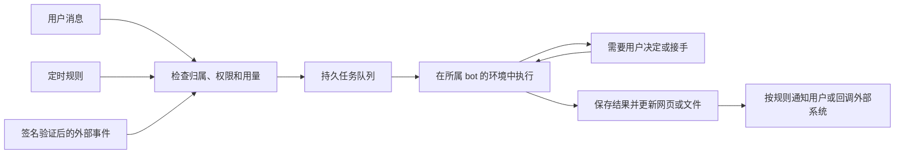

# i-bot 产品方向：Muse、Grok Bot 与 Manus 2.0

调研日期：2026-09-29。Muse 指 Meta 的个人 agent；用户写的 menus 2.0 按 Manus 2.0 调研。

证据范围：官方发布、产品与 API 文档，以及当前工作区代码。竞品没有登录实测；公开能力说明不能证明所有账号可用，也不能证明任务成功率。文中的产品方案、优先级和验收要求是对 i-bot 的建议，尚未实现。

## 1. 建议的产品定位

**用户把一件事或一项长期职责交给个人 agent，由它完成、跟进，并在需要用户时回来。**

从用户需求组织产品：查清楚一件事、处理一批事务、持续关注变化、推进一个长期目标。一次任务可以交付文件、消息、网页或已完成的操作；成功的方法可以保存成技能，再按时间或事件运行。用户通过对话交代事情，查看结果，补充必要信息，并随时改变方向或停止。

结果形式由任务决定：比较资料可以返回有来源的建议，整理文件可以返回可下载文件，安排会议可以返回已建立的日程，持续关注可以只在变化时发消息。网页创作作为其中一种交付能力，继续遵守已有独立项目、design.md、预览和发布要求。

### 2026-09-29 用户补充：按“agent 可以帮我做什么”思考

下面是建议验证的产品场景，不表示当前已经全部实现。

| 用户需要 | 可以交给 agent 的事情 | 完成的标志 |
| --- | --- | --- |
| 帮我查清楚 | 收集多处资料，核对出处，比较方案，给出有依据的建议 | 用户能据此做决定，来源与未确认内容清楚 |
| 帮我处理琐事 | 收集发票、整理文件、填表、从一个系统录入另一个系统 | 实际文件或系统状态已更新，异常明确列出 |
| 帮我安排事情 | 根据双方空闲安排会议，准备材料，跟进缺失信息 | 时间与参与人确定，材料齐全，待办有人负责 |
| 帮我盯住变化 | 关注主题动态、截止日期、订单状态、某个后台的异常 | 只在符合条件的变化时提醒，并说明下一步 |
| 帮我持续推进 | 活动筹备、资料收集、内容发布计划、项目跟进 | 阶段目标有进展，依赖和期限明确，用户能调整计划 |
| 帮我产出和交付 | 完成报告、表格、演示文稿、图片、回复草稿或网页 | 结果可直接使用，必要时可继续修改或送到指定位置 |

产品入口用“你想交给我什么事情”引导，提供少量真实示例，并依据用户已授权的账号和资料推荐能完成的任务。首次先完成一件具体事，再建议保存方法或长期负责。每个建议说明会用什么信息、最后交付什么；缺少账号时指出需要连接哪个服务。

用户应能看见三类信息：正在处理的事情、需要本人处理的事项、已经完成的结果。长期职责显示当前进展、最近结果和下次行动。桌面在需要查看执行或接手时提供；文件、报告、日程、消息与网页各用适合的展示方式。

首次可以默认一个个人 bot；用户需要分开工作与生活、客户账号或不同职责时，再增加 bot。bot 之间按任务明确传递资料，保持现有环境与账号隔离。

## 2. 三个产品分别值得借鉴什么

### Meta Muse：个人目标、持续执行、主动通知

Muse 于 2026-09-08 发布。官方描述每个人有独立云电脑，可用浏览器和连接的应用执行工作，关闭 app 后继续推进，遇到发送邮件、购买等敏感动作请求用户决定。[发布说明](https://about.fb.com/news/2026/09/introducing-muse-personal-ai-agent/)

设计说明包含长期目标、记忆、时间和事件驱动的后台工作，以及交互网页等结果。主对话与侧对话并存；主动消息只在有意义的新结果或需要用户时出现；活动、权限和记忆可查看。[产品设计说明](https://introducing.muse.ai/)

技术说明把凭证服务、权限判断和 agent 执行隔离，连接器与出站请求经过独立 Sentinel，真实凭证由系统代用。Confidential VM 在发布时属于后续计划，不能把它算作当前默认能力。[安全架构](https://research.meta.ai/blog/security-and-safety-for-ai-agents-our-approach-with-muse)、[发布说明](https://about.fb.com/news/2026/09/introducing-muse-personal-ai-agent/)

Connect 后续公告还介绍语音、更多连接器，以及 agent 邮箱和眼镜方向；邮箱与部分硬件使用将来时表述，本次不将其计为已经全面可用。[2026-09-24 官方公告](https://about.fb.com/news/2026/09/the-biggest-news-from-connect-2026/)

对 i-bot 的启发：用户交代目标后，bot 能持续跟进；通知有明确价值；网页登录和动作授权有独立控制。Muse 能生成网页，但本次来源没有确认其面向公众的网页托管或开发者入站 webhook 契约。

### Grok Bot：有职责的 bot、示范教学、可重复执行

官方介绍强调有名字和职责的 bot，持续积累上下文，在浏览器、文件和终端中办事；支持 bot 协作。其隔离单位是用户电脑：同一用户的 bots 共享文件、浏览器会话与登录，bot 对话和记忆分别保存。[产品概览](https://docs.x.ai/grok-bot/overview)

Skill 描述怎么完成任务，routine 描述何时执行。可以从一次成功任务保存方法、通过示范生成技能草稿，再设置时间或受支持的事件触发；routine 有试运行、暂停、下次运行和结果查看。[Skills and routines](https://docs.x.ai/grok-bot/skills-routines-and-automations)

界面区分工作中、新结果和需要关注；通知面向完成或需要输入。审批显示具体操作，可单次允许、保存规则或拒绝，自动审核属于模型判断，仍需有限权限。[通知](https://docs.x.ai/grok-bot/settings-and-notifications)、[动作审批](https://docs.x.ai/grok-bot/approvals-security-and-privacy)

对 i-bot 的启发：保留已有录制、技能草稿和 bot 身份，在成功任务上增加“以后这样做”的自然语言入口。我们的一 bot 一 sandbox 可以分别承载不同账号和客户环境；跨 bot 协作应明确传递文件与任务，不默认共享登录。

### Manus 2.0：创作、发布、事件自动化

官方于 2026-09-28 发布 2.0，强调按需加入专业能力的 Cascade、Studio、事件触发 Automations、Cloud Computer 和独立个人 agent 产品 Cue。网页发布、域名与定时任务已有此前版本基础，不能统称为 2.0 新增。[2.0 首发](https://manus.im/blog/introducing-manus-2-0)、[产品发布索引](https://manus.im/blog/product)

网页预览之后有独立生产构建与托管，可更新、接自定义域名并配置 HTTPS；托管支持按请求扩容或常驻进程两种方式。[网页发布](https://manus.im/docs/website-builder/publishing)

Automations 支持时间、事件及自然语言生成流程（Beta）。Webhook 是入站来源之一；部分来源及时推送，其他来源周期检查。可试运行、暂停，并在可用时继续原任务更新既有结果。[Automations](https://manus.im/docs/automations)、[官方完整 Markdown](https://manus.im/docs/automations.md)

API 另有出站任务回调。任务等待输入、具体动作确认和后台任务未结束是不同状态；主 agent 停止不能直接当成全部完成。[任务生命周期](https://open.manus.im/docs/v2/task-lifecycle)、[回调契约](https://open.manus.im/docs/v2/webhooks-overview)

Cue 的官方设定是每个 agent 有自己的邮箱、电话、钱包和电脑，属于早期访问产品。这比 Studio 更接近 i-bot 的个人 bot 设定；身份和支付实际边界未在账号核实。[2.0 首发](https://manus.im/blog/introducing-manus-2-0)

更多来源与限制见 [Manus 专题](/Users/mac/dev/i-bot/docs/research/manus-product-capabilities.md)。

## 3. i-bot 目前已经有什么、缺少什么

下表来自当前代码，描述实现范围，不等同于生产稳定性保证。

| 方面 | 已有实现 | 需要补齐 | 代码依据 |
| --- | --- | --- | --- |
| 替用户执行 | CDP 浏览器、桌面、终端、人工接管；同一 bot 的桌面操作互斥 | 对具体外部写入的授权、执行与恢复 | [工具](/Users/mac/dev/i-bot/apps/api/src/agent/tools.ts)、[GUI 租约](/Users/mac/dev/i-bot/apps/api/src/sandbox/gui-lease.ts) |
| 后台任务 | 有任务行、并发上限、取消与结果回到对话 | 持久队列、worker 租约、执行进度、重启恢复 | [任务管理](/Users/mac/dev/i-bot/apps/api/src/agent/jobs.ts:158) |
| 任务重启 | 启动时将孤立 running 行标记 error | 恢复可重做的步骤；外部效果不明时查证或等用户，不能盲目重试 | [孤立任务处理](/Users/mac/dev/i-bot/apps/api/src/agent/jobs.ts:153) |
| 用户接手 | request_handoff、等待人工状态、noVNC；新消息继续处理 | 持久保存待批准的具体动作，与缺信息、网页登录区分 | [运行接口](/Users/mac/dev/i-bot/apps/api/src/agent/run.ts:187)、[等待状态](/Users/mac/dev/i-bot/apps/api/src/sandbox/manager.ts:564) |
| 消息通知 | 当前对话的 SSE 与后台结果回传 | 跨进程事件、离线通知、去重、只通知有意义的变化 | [事件总线](/Users/mac/dev/i-bot/apps/api/src/events/bus.ts:1) |
| 网页创作 | /web 插件、自动目录和端口、设计参考、生图、独立 design.md、多网页预览 | 稳定发布、整项目保存与恢复、更新同一发布地址 | [当前流程](/Users/mac/dev/i-bot/docs/web-creation-workflow.md) |
| 多网页识别 | 根据对话中的标题、目录与预览工具结果识别 | 把当前选中项目传入请求，让“改这个”有明确目标 | [预览状态](/Users/mac/dev/i-bot/apps/web/src/components/WorkspacePreview.tsx:18)、[请求只含 parts](/Users/mac/dev/i-bot/apps/web/src/components/ChatPanel.tsx:102) |
| 结果保存 | 对话规范、附件表、R2 存储抽象；生图可存对象副本 | 文件交付、项目源码与 design.md 的完整保存、归属和恢复 | [存储](/Users/mac/dev/i-bot/packages/storage/src/index.ts)、[生图](/Users/mac/dev/i-bot/apps/api/src/agent/web-image.ts) |
| 技能与插件 | 安装启用、手动命令、渐进加载、录制与草稿审核、MCP | 自动化所需的明确权限、连接器授权与失败修复入口 | [插件解析](/Users/mac/dev/i-bot/apps/api/src/plugins/resolve.ts)、[录制](/Users/mac/dev/i-bot/apps/api/src/agent/recording.ts) |
| 定时与事件入口 | 当前路由和 schema 未发现对应调度、触发器与 webhook 产品实现 | 时间与事件规则、试运行、暂停、去重、结果去向 | [路由装配](/Users/mac/dev/i-bot/apps/api/src/server.ts:55)、[数据库](/Users/mac/dev/i-bot/packages/db/src/schema.ts) |
| 长期个人上下文 | bot persona、对话历史和技能持久保存 | 可查看、修正、删除的偏好与长期目标；跨对话使用需权限边界 | [上下文组装](/Users/mac/dev/i-bot/apps/api/src/agent/resolve.ts)、[技能加载](/Users/mac/dev/i-bot/apps/api/src/agent/skills.ts) |

实现文档中的 Mastra/NestJS/assistant-ui 设定与当前主路径并不完全一致：本次读到的是 Hono 路由、AI SDK streamText/createAnthropic 和 @ai-sdk/react。后续设计恢复与调度时，要明确如何落在锁定的技术体系中，不能认为框架已替我们接好了这些功能。[服务装配](/Users/mac/dev/i-bot/apps/api/src/server.ts)、[模型](/Users/mac/dev/i-bot/apps/api/src/agent/model.ts)、[运行](/Users/mac/dev/i-bot/apps/api/src/agent/run.ts)、[聊天](/Users/mac/dev/i-bot/apps/web/src/components/ChatPanel.tsx)

## 4. 产品交互应该怎样调整

### 任务与结果

- bot 除了工作中，还明确显示：已完成、需要信息、需要批准、需要登录或人工接手、失败、已停止。不同状态对应不同处理方式。
- 结果卡片显示文件、日程、消息草稿、网页或已经完成的动作；附简短完成说明、依据和下一步。用户可继续修改、下载、按授权交付，或要求以后重复执行。
- 初始输入围绕具体事情：“收集资料”“整理文件”“关注变化”“处理一次事务”。示例应说明实际交付，不把底层工具名称作为主要入口。
- agent 先理解目标、范围和完成标准；已知信息与已有授权可沿用。执行中只询问真正缺少的信息或需要用户决定的事项。用户可以中途补充、修改方向和停止。
- 用户说“发布这个”时，使用当前选中的结果；指定标题时解析对应项目；明确说“新建”时新建；没有结果时生成。多个候选且没有可验证指向时，只询问目标名称。
- 页面选择通过稳定项目引用传给服务端，并重新验证 bot 归属。端口、目录和 URL 是服务内部信息；当前页面引用不能由客户端绕过归属检查。

### 自动化

用户在成功完成一次后说：“以后每周五这样做”“有新报名就帮我处理”。agent 给出一张可以修改的规则卡：

| 卡片字段 | 用户看见的内容 |
| --- | --- |
| 由谁执行 | 当前 bot 与使用的账号 |
| 何时执行 | 日期、时间、时区；或具体事件与匹配条件 |
| 执行什么 | 清楚的动作和结果要求 |
| 更新哪里 | 原网页、原文件或当前对话 |
| 可以做到哪一步 | 已授予的范围，哪些动作需要本人决定 |
| 怎么通知 | 完成、失败或需要用户时；有变化才通知 |
| 用量限制 | 运行次数、时间和费用上限 |

支持先运行一次、暂停、修改和停用。已有授权可沿用；新规则只要求用户决定尚未授权的范围。每次运行都有自己的状态和结果，可继续同一个对话、更新同一个网页。

### 主动建议与记忆

用户不必逐项创建任务。agent 可以从已授权的信息、对话背景、长期目标和新事件中发现值得处理的事情，主动准备，按已有授权执行，并在有结果或需要决定时回来。以下为建议能力，尚未实现。

| 发现的情况 | 可以主动做什么 | 给用户的反馈 |
| --- | --- | --- |
| 明天有会议，相关资料散在邮件和文件里 | 收集资料、整理议题、列出未解决问题，生成私人会议准备材料 | “明天会议的材料已整理，另有两项需要你决定。” |
| 收到通知，其中有快到期的提交或报名要求 | 提取期限、检查已有材料、准备表格，缺少必要信息时提醒 | 说明截止时间、准备情况和缺失项 |
| 承诺跟进的事情还没有后续，或已有目标出现阻塞 | 核对当前状态，准备下一步或催办草稿 | 给出有依据的进展和最少需要用户处理的事项 |
| 用户关注的主题出现与当前目标相关的新资料 | 核对来源、评估影响、更新已有整理 | 只在资料会改变判断或行动时通知 |
| 在已授权查看的数据里发现重复资料、异常记录或遗漏 | 查证并整理，按授权分类，准备可检查的修正 | 展示依据、已完成的处理与仍需决定的修改 |
| 多次执行同一种重复事务 | 归纳已经验证的方法，提出持续代办建议 | 具体说明以后能负责什么、频率和已有授权范围 |

#### 主动的程度

1. **主动发现**：说明发现了什么、为什么与用户有关，以及能帮助什么。
2. **主动准备**：检索、核对、整理、生成私人草稿和材料；有实际内容后再找用户。
3. **按授权主动执行**：在明确允许的账号、范围和用量内完成操作，用户无需重复发起。
4. **持续负责**：保存当前进展和后续条件；新事件发生后继续推进，直到完成、停止或需要用户。

主动发现需求与取得动作授权分别处理。已有授权覆盖的动作正常执行；向外发送、购买、删除或公开发布等动作按已批准范围执行，超出范围才要求用户决定。聊天中的想法不会自行安装插件，也不会被当成无限制的自动执行许可。

#### 首次设置与日常体验

用户只需选择愿意连接的资料与账号，以及是否让 agent 主动关注。可以选择自然语言职责，例如“替我关注近期日程和未完成事项，提前准备资料”；不要求用户自己写每个触发条件。日常从已有背景发现具体任务，保留来源和理由。没有信息来源或相关背景时，先提供有限建议，不推断不存在的个人事务。

结果可以呈现为“已替你准备”“已按授权完成”“需要你决定”三类；用户可直接继续、修改、忽略或关闭这类主动关注。用户拒绝某类建议后应降低或停止该类建议，明确停止关注后不再继续采集相关信息。

通知取决于是否有实际价值：期限临近、状态变化影响目标、已经产出可用结果或需要用户决定。相同事项去重，无变化保持安静；非紧急内容集中呈现，用户可设置通知频率和安静时间。

#### 实现所需

在持久任务与事件处理基础上，增加有范围的观察来源、用户目标和进展、候选事项记录、结果去重和通知判断。外部事件与定期检查让 agent 有机会评估；模型结合背景判断是否值得做、应该用哪个技能。先做事件筛选，再读相关内容，避免频繁全量读取。

首批建议验证会议前准备、临近期限材料检查、已有任务后续跟进。这些场景与用户既有事项直接相关，容易检查主动行为是否有帮助。长期目标和从行为中推荐新职责可以随后扩展。

优先记住用户明确偏好、来源和有效范围，让用户查看、修改、删除。用户账户偏好与不同 bot 的客户信息分开；不能因为同属一人就把一个客户的内容带进另一个 bot。

## 5. 网页发布怎么落地

### 第一阶段：已有 React + Vite 项目的静态发布

1. 读取确定的项目、源码、design.md 与资源，完成生产构建和页面检查。
2. 将可恢复的源码和资源保存到对象存储，数据库记录归属和版本引用。
3. 服务端发布工具把构建产物交给托管服务，配置稳定 HTTPS 地址、内容类型与前端路由。
4. 实际访问发布地址，确认 HTML、脚本、图片和主要操作可用，才返回“已发布”。
5. 修改先在 sandbox 预览；发布时更新同一个地址，失败保留上一个可用版本。支持撤下和恢复上一版本。

技术候选：Cloudflare Pages Direct Upload 可以接收已有构建产物；规模扩大时，可评估 Workers for Platforms 的用户 Worker 与静态资源机制。这里是候选，不表示已经配置 Cloudflare 发布凭证或购买服务。[Pages Direct Upload](https://developers.cloudflare.com/pages/get-started/direct-upload/)、[平台静态资源](https://developers.cloudflare.com/cloudflare-for-platforms/workers-for-platforms/configuration/static-assets/)

R2 可以保存源码、资源和版本；单纯上传 R2 对象不足以完成应用托管，还需域名、路由、访问控制和正确响应。发布的网站使用与平台登录界面隔离的域名，发布凭证只由服务端工具使用。

公开发布由用户的明确要求或已有自动发布授权驱动；仅生成预览不自动公开。更新已有页面时沿用该页面的访问规则。

### 第二阶段：表单和动态网页

报名、留言、预约表单先接平台提供的有限接口：提交、校验、存储、通知与触发任务。不要为一个表单立即引入用户任意后端的完整运维。

需要数据库、登录、SSR 或常驻进程的应用，再选择独立运行方式。Next.js 服务不能直接按 Vite 静态产物发布；例如 Workers 的 Next.js 部署依赖 OpenNext 适配，需验证项目用到的服务端功能。[Cloudflare Next.js 部署](https://developers.cloudflare.com/workers/framework-guides/web-apps/nextjs/)

开发 sandbox、已发布网站和 bot 的周期任务分别管理生命周期。关闭开发桌面后，已发布结果继续可用；重建 sandbox 后，可以恢复源码和 design.md 再修改。

## 6. 自动化与 webhook 的实现边界

### 三种输入，共用一次任务执行

平台负责归属、规则、队列、权限、用量和状态；agent 负责理解内容、选用技能、执行步骤和解释结果。计划与授权状态保存在我们拥有的数据库中，不能只写进 sandbox 的 cron。

### 入站 webhook：别人触发我们的 bot

例如表单报名、GitHub 事件、外部系统订单：验证签名、时间和归属；记录事件并去重；通过匹配规则后排入队列，快速返回已接收。一次事件重发多次只产生一次有效执行。

每个入口绑定允许的 bot、任务、数据字段和动作范围。事件正文作为外部数据处理，不能把正文中的指令当成新的用户授权。提供暂停、速率和日用量限制。

### 出站 webhook：我们的 bot 通知别人

任务完成、失败或等待用户后，向已登记的回调地址发送签名事件。使用可重试的持久发送记录、事件 ID、时间戳和失败处理，收方按事件 ID 去重。等待批准属于等待状态，不能发成完成。

网页访客按钮可以经有限接口触发一个预先授权的任务，例如查询公开资料或整理报名；访客不因此获得 bot 的浏览器、凭证或任意执行权限。

### 执行恢复与批准

先补排队、运行、等待、完成、失败、取消等状态，worker 领取和续租，保存必要的步骤进度。重复读取与构建可重试；发送、支付、删除等外部效果不明时，需要查询实际结果或请用户决定。

批准记录绑定具体目标和参数、用户、有效期和允许次数，由工具执行前核对。已有授权范围内正常执行；凭证授权、回答问题、批准操作和网页登录分别处理。浏览器的任意点击较难准确判断效果，应先支持范围明确的连接器动作，浏览器写入增加可检查的执行边界。

当前步数上限和并发上限继续使用，并补实际任务时长、费用和自动运行频率限制。自动化持续失败应暂停并解释原因；没有新变化时保持安静。

## 7. 插件、skill 与 design.md 怎么配合

- **平台能力**：项目归属、结果保存、发布、队列、调度、批准和通知，需要服务端实现与共享契约。
- **Plugin**：把网页创作、发布、连接服务、自动化的技能、工具入口和资源包装成可安装的能力，按 bot 启用。
- **Skill**：描述何时使用、怎么完成、失败怎么办、怎样检查结果；按需加载。
- **design.md**：约束一个生成项目的内容、视觉、交互和实现；随着同一个项目修改继续更新，并随源码保存。

继续保持 /web 主动调用。发布和自动化可以提供清楚的主动入口，用户授权后由执行服务按规则调用所需能力。安装插件、加载技能与授权某项外部动作是三件事，不能相互代替。

## 8. 可先做的三个实际场景

| 场景 | 一次交付 | 持续执行 | 用户价值 |
| --- | --- | --- | --- |
| 信息收集与判断 | 多来源调研、对比、有来源的简报 | 定期检查同一主题，有重要变化再提醒 | 节省重复搜索和阅读，支持实际决定 |
| 重复事务处理 | 文件整理、发票收集、订单核对或系统录入 | 沿用一次验证成功的方法，定时或收到事件后执行 | 用户减少在多个系统之间反复操作 |
| 长期事项跟进 | 明确活动或项目的目标、当前待办与依赖 | 追踪期限、缺失材料和状态，按授权推进下一步 | 用户不用反复重述背景，也不用自己记住所有进展 |

这些是建议的首批验证场景，不是已完成或已验证的业务效果。先选择有现成账号和明确数据来源的场景，实测任务成功、等待原因和结果可达。

例如用户说：“帮我筹备下个月的读书分享会，30 人左右，场地还没定，报名和材料也一起跟进。”

agent 根据已知地点、时间和预算整理场地候选，说明需要用户决定的事项；选择之后跟进预订、参与人、报名名单和材料。报名入口可以采用用户现有工具；需要独立展示时再生成网页。日常只报告重要进展、异常或待决定事项。对外联系和预订沿用已有授权，范围不足时展示具体对象和操作供决定。

## 9. 推荐开发顺序与验收

| 阶段 | 建议范围 | 验收标准 |
| --- | --- | --- |
| 第一批 | 一次完整代办：清楚的目标、执行、结果交付、异常说明；必要的账号连接 | 三类试点各完成真实任务；结果可使用；用户不用重复提供已有背景；停止与接手有效 |
| 同时补基础 | 持久任务队列、步骤进度、等待状态、结果保存和通知；已有批准可延续 | worker 重启不丢任务；多实例不会重复执行；待批准状态可恢复；用户离线后仍能收到结果 |
| 第二批 | 从成功任务建立定时或关注规则；试运行、暂停、用量限制 | 时区正确；同一桌面互斥；来源失败明确报告；连续失败可暂停；无变化不重复通知 |
| 第三批 | 长期目标与可修正偏好；入站与出站 webhook；少量实用连接器 | 不同对话能继续同一事项；偏好可查看删除；事件去重；跨租户隔离；等待与完成正确区分 |
| 按场景扩展 | 网页发布、更多文件交付、动态应用、更多通知渠道与 bot 协作 | 用具体用户需求选择扩展；网页有稳定链接和完整恢复；协作不默认共享登录 |

用户已经提出的网页发布需求继续保留在能力计划中。整体顺序以一件事能办完、结果能交付、以后能持续负责为依据；对用户开放持续自动化应以重启恢复、授权和通知可用为前提。先通过真实场景测完整流程，再扩展更多输入渠道和插件。

商业方案可以先采用订阅执行额度，加独立透明的托管用量和自动运行上限；当前主路径使用用户自己的模型凭证，须先明确继续采用自带凭证还是平台提供额度。价格应根据试点的实际模型、sandbox、存储和托管成本确定。

建议观察的指标：任务验收成功率、用户实际减少的操作、需要人工接手的原因、自动化连续成功次数、发布链接持续可用性、每个成功结果的成本，以及任务失败后是否能恢复。竞品发布文章的效率数字不作为我们的指标基线。

## 10. 本次未确认事项

- 三个竞品的套餐、地区、账号灰度、实际第三方操作成功率，没有账号验证。
- Muse 的公开网站托管、用户应用 API 和 webhook 契约未从本次来源确认；Grok Bot 的事件来源也不是任意第三方 webhook 已全面开放的证明。
- Manus 2.0 刚发布；Cue 身份、支付、Cloud Computer 备份与恢复细节未实测。各类 webhook 的出站签名不能用来推断其入站保护。
- i-bot 本次检查当前工作区；没有重新跑模型、生产发布或验证所有历史功能。bootstrap 的注释不能当作网关当前模板和快照限制的最新实测结果。
- 本次产出研究文档与建议，没有实施上述产品变更。
